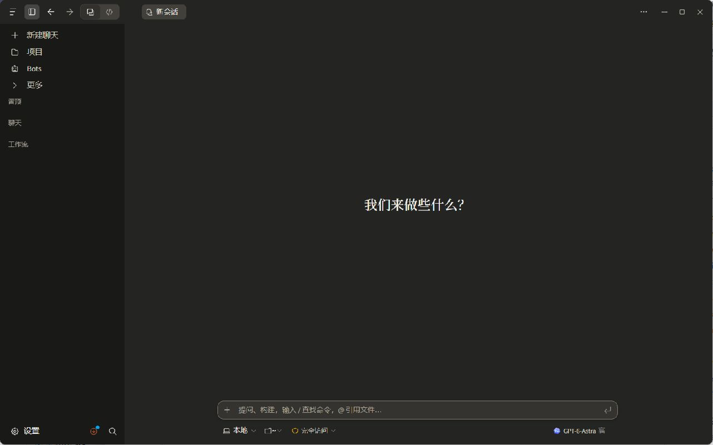

# OmniCode

简体中文 · [English](README.en.md)

把 AI 编程智能体、项目和工具放进同一个工作区。

基于上游项目持续开发的个人分支。使用 Tauri、React 和 TypeScript 构建，包含桌面应用、共享 Host 与移动客户端。



## 功能

- **多智能体**：接入 Claude Code、Codex、OpenCode、Pi、OMP 等，统一管理会话与模型选择。
- **项目工作区**：文件浏览、内置终端、Git 差异审查、分支与 worktree 管理。
- **任务与工作流**：子智能体、可复用工作流，以及 Bots、笔记和自动化工具。
- **跨设备**：通过共享 Host 连接远程电脑，Android / iOS 客户端可访问项目与会话。
- **界面**：中文 / 英文、明暗主题，支持对话与代码工作区切换。

## 开发启动

准备 Node.js 24+、稳定版 Rust、对应平台的 Tauri 原生依赖，以及至少一个已安装并登录的智能体 CLI。

```sh
git clone https://github.com/haoyw7/OmniCode.git
cd OmniCode
npm ci
npm run tauri dev
```

Windows 需安装 Visual Studio C++ Build Tools 与 WebView2；Linux 依赖安装脚本见 `scripts/install-linux-deps-*.sh`。启动桌面应用时会自动启动共享 Host。

## Android APK 构建与发布

以后构建、交付和发布 APK，默认使用 Release 构建，并复用 2026-10-18 首次正式发布
（0.1.0，build 3）的 OmniCode 正式签名密钥。文件名固定为 **`OmniCode.apk`**，
不添加版本号或其他后缀，应用名称保持 **OmniCode**。除非明确要求调试包，不使用调试签名；
密钥不可用时停止签名发布，不生成新密钥替代。密钥位置、证书指纹及验证流程见
[移动端发布与签名说明](mobile/README.md#release-signing-key)。

## 更多

[移动端与 Host 连接](mobile/README.md) · [开发说明](CONTRIBUTING.md) · [更新日志](CHANGELOG.md)

采用 [MIT 许可证](LICENSE)。第三方组件与素材声明见 [NOTICE](NOTICE)。
